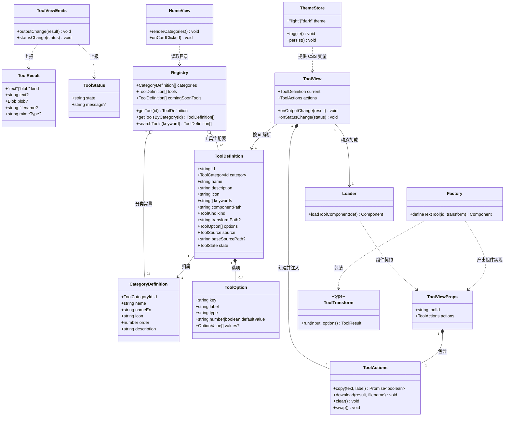
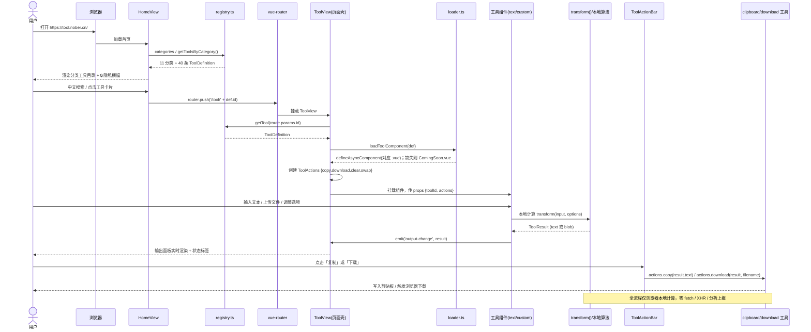

# DevToys Web — 系统架构设计与任务分解

> 文档版本：v1.0 ｜ 作者：高见远（架构师）｜ 输入：PRD v1.0（许清楚）｜ 语言：中文
> 决策依据：主理人已拍板 Q1–Q6（见 §1.1），本文件不再讨论已定事项。
> **接口契约自 v1.0 起冻结**，后续工程师按此实现，不得自行改字段/命名。

---

## 1. 实现方案与技术栈

### 1.1 已定决策（不再讨论）

| 编号 | 决策 |
|---|---|
| Q1 | **优先复用 MIT 基座 `HeHang0/devtoys`** 作为工程基座与工具实现来源；必须先过 §1.3 验证清单，失败才回退新建 Vite + React + TS |
| Q2 | P0 工具 **40 个，不缩减** |
| Q3 | DNS 由用户在 nober.cn 的 DNS 服务商自行添加 `tool` CNAME → `ljnober.github.io`；**DNS 不是代码任务** |
| Q4 | **中文界面优先**；基座 i18n 可保留，英文非首版验收项 |
| Q5 | 首版**不做** URL 状态分享、数据上传、分析统计 |
| Q6 | PWA 可保留但**非首版验收项**；本架构首版关闭（理由见 §1.4） |

### 1.2 基座评估结论

| 维度 | `HeHang0/devtoys` 现状 | 结论 |
|---|---|---|
| 技术栈 | Vue 3.3 + TS 4.8 + Vite 4 + Element Plus + Pinia + vue-router | ✅ 直接复用，工程师上手成本低 |
| 许可证 | MIT，Copyright (c) 2023 He Hang（已核对 LICENSE.md 全文） | ✅ 可商用改造，须保留署名（§1.3 / §7） |
| 工具数量 | `src/views/` 约 42 个 SFC，README 列 30+ 工具 | ✅ 可覆盖 P0 约 22 个，其余 18 个新建 |
| 工具注册 | `src/stores/menu.ts` 数组 + `src/router/index.ts` 动态 `import('../views/${key}.vue')` | ⚠️ 字段过简（无 keywords/category 常量），需替换为 §3 冻结注册表 |
| 首页 | `home.vue` 平铺卡片，**无分类分组** | ⚠️ 需按 devtoys.pro 风格改为 11 分类分区 |
| 工具页 | 工具 SFC 自带完整 UI，无统一输入/输出/操作栏契约 | ⚠️ 需引入 §3 的 `ToolActions` 契约与 `IoPanel` |
| 主题 | CSS 变量 + `element-plus/theme-chalk/dark/css-vars.css` | ✅ 保留，接入 `ToolDefinition` 无关的 theme store |
| i18n | `useLanguageStore` + 键名（如 `tool.jsonyaml.title`） | ⚠️ 首版改为中文直出 + 键名兼容层 |
| PWA | `vite-plugin-pwa`，但 `start_url: 'devtoys'`、`outDir: 'devtoys'` | ❌ 与本项目路径不匹配，首版关闭 |
| 部署 | 官方 Pages Action + `404.html` 跳转 hack，`outDir: devtoys` | ❌ 改为 gh-pages 分支工作流（§8） |
| **CDN 风险** | `vite-plugin-cdn2` 在生产注入 cdnjs/jsdelivr 的 14 个 `<script>`；`vue-monaco-cdn` 依赖外部 Monaco | ❌ **必须删除**，否则用户网络受限时部署后打不开（主理人红线） |
| 无关依赖 | amap / googlemaps / maptiler / cron-parser / exifr / heic2any 等对应非 P0 工具 | ⚠️ 随非 P0 视图一并删除，减小体积 |

**结论：复用基座，但不是「拿来即用」——进行"骨架迁移 + 工具实现移植 + UI 重写 + CDN 去毒"四步改造。**

### 1.3 复用前置验证清单（工程师 T01 必须先执行，逐项打勾）

| # | 检查项 | 通过标准 | 失败处理 |
|---|---|---|---|
| V1 | MIT 署名 | 仓库根保留 `LICENSE.md`（Copyright (c) 2023 He Hang）原文；新增 `NOTICE.md` 说明衍生关系；README 署名 | 不通过则不得合并 |
| V2 | 本地构建 | Node 20 下 `npm install && npm run build` 退出码 0，`dist/` 含 `index.html` 与 `assets/` | 修 TS/构建错误；超过 1 天未修复 → 触发回退 |
| V3 | **CDN 去毒** | `dist/index.html` 与 `dist/**/*.js` 中 **不出现** `https://cdnjs.cloudflare.com`、`https://cdn.jsdelivr.net`、`https://unpkg.com` 等外链；已移除 `vite-plugin-cdn2`、`vue-monaco-cdn`、`MonacoEditor.vue` | 必须修好，属主理人红线 |
| V4 | 隐私合规 | 全仓 `grep` 无 `fetch(`/`XMLHttpRequest(`/`axios` 的用户数据外发；`CompressionStream` 等均为本地 API | 必须修好 |
| V5 | 路径可达 | `base: './'` 下本地 `npm run preview`，刷新 `/tool/regex-tester` 不 404 | 修路由为 hash 模式或加 404 兜底 |
| V6 | 工具覆盖 | 40 个 `ToolDefinition` 均可点击渲染（未实现工具显示"开发中"占位而非白屏） | 补占位组件 |

> **回退方案（仅在 V1–V6 任一失败且无法短期修复时启用）**：新建 Vite + React 18 + TS 项目，UI 用 MUI + Tailwind，全部 40 工具从零实现，包管理 npm，部署方案 §8 不变。回退需先向主理人报备，**不得由工程师自行改选**。

### 1.4 关键改造点

1. **去 CDN / 去 Monaco**：删除 `vite-plugin-cdn2`、`vue-monaco-cdn`、`vite-plugin-monaco-editor`、基本 SSL 插件；代码编辑统一用 `<textarea>` + `highlight.js` 只读高亮，零外部资源。
2. **注册表替换**：删除 `src/stores/menu.ts` 的旧菜单结构，改用 `src/tools/registry.ts`（§3.2 冻结），路由收敛为单条 `/tool/:id`。
3. **工具组件契约化**：所有工具统一 `ToolViewProps` / `ToolActions`（§3.4–3.5）；文本类工具用 `defineTextTool()` 工厂消除样板代码。
4. **UI 按 devtoys.pro 风格重写**：
   - 首页：Header（Logo + 中文搜索 + 主题切换 + 语言标识）→ 隐私横幅 → 11 个分类分区 → 工具卡片（图标 + 中文名 + 一行描述）。
   - 工具页：返回 + 标题 + 中文说明 + 隐私小标签 → 左侧分类导航 → 输入/输出双栏 → 操作栏（复制 / 下载 / 清空 / 交换）。
   - 移动端：≤768px 分类导航收进抽屉，双栏改纵向堆叠，触摸目标 ≥44px。
   - 主题：CSS 变量 `tokens.css` 统一，偏好写入 `localStorage`，默认浅色。
5. **首版关闭 PWA**：基座 PWA 的 `start_url`/`outDir`/图标路径均与本项目不符，且非验收项；P1 按新路径重新启用。
6. **依赖瘦身**：删除非 P0 工具视图及其专属依赖（地图 SDK、cron、EXIF、HEIC 等），保留下述 §6 依赖。

### 1.5 40 个工具的基座复用映射

> 来源列 `基座:xxx.vue` = 移植该文件的核心算法/模板；`新建` = 无对应实现。`text` = 输入→变换→输出的通用工具；`custom` = 需自有 UI（取色器/画布/差高亮等）。

| # | id | 中文名 | 分类 | 来源 | kind |
|---|---|---|---|---|---|
| 1 | `json-yaml` | JSON ↔ YAML 转换 | converters | 基座:`json2yaml.vue` | text |
| 2 | `json-xml` | JSON ↔ XML 转换 | converters | 新建（DOMParser + 序列化） | text |
| 3 | `number-base` | 进制转换器 | converters | 基座:`number.vue` | text |
| 4 | `date-time` | 日期时间转换器 | converters | 基座:`date.vue` | custom |
| 5 | `data-size` | 数据大小单位转换 | converters | 新建 | text |
| 6 | `base64-text` | Base64 文本编解码 | encoders | 基座:`base64.vue` | custom |
| 7 | `url-encode` | URL 编解码 | encoders | 基座:`url.vue` | text |
| 8 | `html-entity` | HTML 实体编解码 | encoders | 基座:`html.vue` | text |
| 9 | `gzip` | GZip 压缩/解压 | encoders | 新建（原生 `CompressionStream`） | custom |
| 10 | `jwt-decode` | JWT 解码器 | encoders | 基座:`jwt.vue` | custom |
| 11 | `hex-ascii` | Hex ↔ ASCII 转换 | encoders | 新建 | text |
| 12 | `qrcode-encode` | 二维码编解码 | encoders | 基座:`qrcode.vue` + `rqrcode.vue` | custom |
| 13 | `json-format` | JSON 格式化/压缩/校验 | formatters | 基座:`formatter.vue` | text |
| 14 | `sql-format` | SQL 格式化 | formatters | 基座:`sql.vue` | text |
| 15 | `xml-format` | XML 格式化 | formatters | 基座:`xml.vue` | text |
| 16 | `html-format` | HTML 格式化 | formatters | 新建（`highlight.js` + 缩进） | text |
| 17 | `css-format` | CSS 格式化 | formatters | 新建 | text |
| 18 | `hash-generator` | 哈希/校验和生成器 | generators | 基座:`hash.vue` + `checksum.vue` | custom |
| 19 | `password-generator` | 密码生成器 | generators | 新建（Web Crypto） | custom |
| 20 | `uuid-generator` | UUID 生成器 | generators | 基座:`uuid.vue` | custom |
| 21 | `lorem-ipsum` | Lorem Ipsum 生成器 | generators | 基座:`ligen.vue` | custom |
| 22 | `random-number` | 随机数生成器 | generators | 新建（Web Crypto） | custom |
| 23 | `text-diff` | 文本对比（Diff） | text | 基座:`textdiff.vue` | custom |
| 24 | `text-stats` | 文本分析/统计 | text | 基座:`capitalization.vue`（Inspector 部分） | custom |
| 25 | `markdown-preview` | Markdown 预览 | text | 基座:`markdown.vue` | custom |
| 26 | `string-replace` | 字符串替换 | text | 基座:`replace.vue` | custom |
| 27 | `line-tool` | 行工具 | text | 新建（基座 `hyphen.vue` 已注释） | custom |
| 28 | `ipv4-subnet` | IPv4 子网计算器 | network | 新建 | custom |
| 29 | `ipv6-parse` | IPv6 解析/展开 | network | 新建 | text |
| 30 | `regex-tester` | 正则表达式测试 | testers | 基座:`regex.vue` | custom |
| 31 | `jsonpath-tester` | JSONPath 测试 | testers | 新建（自研轻量解析器，零新增依赖） | custom |
| 32 | `json-schema-validator` | JSON Schema 验证 | testers | 新建（自研常用关键字子集） | custom |
| 33 | `url-parser` | URL 解析器 | testers | 新建（基座 `url.vue` 仅编解码） | custom |
| 34 | `color-converter` | 颜色选择器/转换 | colors | 基座:`color.vue` | custom |
| 35 | `contrast-checker` | 颜色对比度计算器 | colors | 新建（WCAG 公式） | custom |
| 36 | `color-blind-sim` | 色盲模拟器 | colors | 新建（Canvas 矩阵变换） | custom |
| 37 | `image-convert` | 图片格式转换 | images | 基座:`imageconvert.vue` | custom |
| 38 | `image-compress` | 图片压缩 | images | 新建（Canvas `toBlob`） | custom |
| 39 | `http-status` | HTTP 状态码查询 | references | 新建（静态数据） | custom |
| 40 | `mime-types` | MIME 类型查询 | references | 新建（静态数据） | custom |

> 复用统计：基座直接移植 **22 个**，新建 **18 个**。

---

## 2. 完整文件列表及相对路径

> 路径相对项目根 `devtoys-web/`。`[改]`=改造基座同名文件，`[新]`=新建，`[保]`=保留原样。

### 2.1 工程配置与部署

| 文件 | 动作 | 说明 |
|---|---|---|
| `package.json` | [改] | name=`devtoys-web`，npm scripts，删除 CDN/Monaco/PWA/地图依赖（§6） |
| `vite.config.ts` | [改] | `base:'./'`、`build.outDir:'dist'`、移除 cdn2/monaco/basicSsl/PWA、保留 `@` alias |
| `tsconfig.json` / `tsconfig.node.json` | [改] | strict、ESNext、`types:["vite/client"]` |
| `index.html` | [改] | 中文 `lang="zh-CN"`、标题、favicon、meta description |
| `.gitignore` | [改] | 加 `dist/`、`.env.local` |
| `README.md` | [改] | 使用说明 + 基座 MIT 署名 + 部署/域名说明 |
| `LICENSE.md` | [保] | MIT 原文，Copyright (c) 2023 He Hang |
| `NOTICE.md` | [新] | 衍生自 `HeHang0/devtoys` 的署名声明 |
| `public/CNAME` | [新] | 单行内容 `tool.nober.cn`（无多余空格/换行除外） |
| `public/logo.svg` | [新] | 本地 SVG Logo，不引用外链 |
| `.github/workflows/deploy.yml` | [新] | npm 构建 → `peaceiris/actions-gh-pages@v4` → `gh-pages` 分支（§8） |
| `.github/workflows/static.yml` | [删] | 基座官方 Pages Action 工作流删除 |

### 2.2 应用骨架与路由

| 文件 | 动作 | 说明 |
|---|---|---|
| `src/main.ts` | [改] | 创建 Vue app，安装 Pinia/router/ElementPlus，引入 `styles/tokens.css`，**移除 `useRegisterSW()`** |
| `src/App.vue` | [改] | 全局壳：`<AppHeader/>` + `<RouterView/>` + `<PrivacyBadge/>` |
| `src/router/index.ts` | [改] | 路由：`/`→HomeView，`/tool/:id`→ToolView，`/:pathMatch(.*)*`→NotFoundView；**hash 或 history 均可，推荐 history + 404 兜底** |

### 2.3 冻结契约与注册表（地基）

| 文件 | 动作 | 说明 |
|---|---|---|
| `src/tools/contracts.ts` | [新] | §3 全部类型定义（唯一真源，禁止在别处重复声明） |
| `src/tools/registry.ts` | [新] | `categories`(11)、`tools`(40)、`comingSoonTools`(2)、`getTool/getToolsByCategory/searchTools` |
| `src/tools/loader.ts` | [新] | `import.meta.glob('./**/*.vue')` → `loadToolComponent(def)`，缺文件返回 `ComingSoon.vue` |
| `src/tools/factory.ts` | [新] | `defineTextTool(id, transform)` 生成符合 `ToolViewProps` 的组件 |

### 2.4 全局布局与共享组件

| 文件 | 动作 | 说明 |
|---|---|---|
| `src/views/HomeView.vue` | [改自 `home.vue`] | 11 分类分区 + 搜索过滤 + 工具卡片网格 |
| `src/views/ToolView.vue` | [新] | `/tool/:id` 页面壳，加载工具组件并注入 `actions` |
| `src/views/NotFoundView.vue` | [新] | 404 兜底 |
| `src/views/ComingSoonView.vue` | [新] | 未实现工具的占位视图，避免白屏 |
| `src/components/AppHeader.vue` | [改自 `Header.vue`] | Logo + 搜索框 + 主题按钮 + 中文标识 |
| `src/components/CategorySection.vue` | [新] | 单个分类区块（标题 + 计数 + 卡片网格） |
| `src/components/ToolCard.vue` | [新] | 工具卡片（图标 + 中文名 + 描述），点击跳转 |
| `src/components/ToolPageShell.vue` | [新] | 工具页布局：侧栏 / 标题 / 双栏插槽 / 操作栏插槽 |
| `src/components/IoPanel.vue` | [新] | 通用输入/输出双栏（textarea + 只读高亮），移动端纵向 |
| `src/components/ToolActionBar.vue` | [新] | 复制 / 下载 / 清空 / 交换 四个按钮 |
| `src/components/OptionBar.vue` | [新] | 由 `ToolDefinition.options` 渲染下拉/开关/输入框 |
| `src/components/PrivacyBadge.vue` | [新] | 🔒 本地处理·不上传 常驻标签 |
| `src/components/MobileNavDrawer.vue` | [新] | ≤768px 分类抽屉 |
| `src/components/ThemeToggle.vue` | [新] | 深/浅切换按钮 |
| `src/styles/tokens.css` | [新] | 全部 CSS 变量（颜色/间距/圆角/字体），深浅主题各一套 |
| `src/styles/base.css` | [改自 `assets/main.css`] | reset + 布局基础 + 响应式断点 |
| `src/stores/theme.ts` | [改自 `settings.ts`] | `theme: 'light'\|'dark'`，localStorage 持久化 |
| `src/stores/search.ts` | [改] | 基于 `keywords` 的中文/英文模糊搜索 |
| `src/stores/language.ts` | [保/简化] | 默认 `zh-CN`，键名兼容层 |

### 2.5 工具实现（40 个 SFC + 工具函数）

| 目录 | 文件 | 说明 |
|---|---|---|
| `src/tools/converters/` | `JsonYaml.vue` `JsonXml.vue` `NumberBase.vue` `DateTime.vue` `DataSize.vue` | 5 |
| `src/tools/encoders/` | `Base64Text.vue` `UrlEncode.vue` `HtmlEntity.vue` `Gzip.vue` `JwtDecode.vue` `HexAscii.vue` `QrcodeEncode.vue` | 7 |
| `src/tools/formatters/` | `JsonFormat.vue` `SqlFormat.vue` `XmlFormat.vue` `HtmlFormat.vue` `CssFormat.vue` | 5 |
| `src/tools/generators/` | `HashGenerator.vue` `PasswordGenerator.vue` `UuidGenerator.vue` `LoremIpsum.vue` `RandomNumber.vue` | 5 |
| `src/tools/text/` | `TextDiff.vue` `TextStats.vue` `MarkdownPreview.vue` `StringReplace.vue` `LineTool.vue` | 5 |
| `src/tools/network/` | `Ipv4Subnet.vue` `Ipv6Parse.vue` | 2 |
| `src/tools/testers/` | `RegexTester.vue` `JsonpathTester.vue` `JsonSchemaValidator.vue` `UrlParser.vue` | 4 |
| `src/tools/colors/` | `ColorConverter.vue` `ContrastChecker.vue` `ColorBlindSim.vue` | 3 |
| `src/tools/images/` | `ImageConvert.vue` `ImageCompress.vue` | 2 |
| `src/tools/references/` | `HttpStatus.vue` `MimeTypes.vue` | 2 |
| `src/tools/calculators/` | （空目录，P1 扩展位） | 首页以 `comingSoonTools` 占位展示 |
| `src/utils/` | `clipboard.ts` `download.ts` `gzip.ts` `jsonpath.ts` `jsonSchema.ts` `ip.ts` `color.ts` `transformers.ts` | 8 个纯函数模块，零网络调用 |
| `src/data/` | `httpStatus.ts` `mimeTypes.ts` `lorem.ts` | 静态字典 |
| `src/tools/ComingSoon.vue` | [新] | 占位组件 |

### 2.6 测试与设计产物

| 文件 | 动作 | 说明 |
|---|---|---|
| `tests/contracts.test.ts` | [新] | 校验 40 条定义的 id 唯一、分类合法、字段齐全 |
| `tests/smoke.test.ts` | [新] | 抽查 7 个核心工具变换函数（PRD A4） |
| `docs/ARCHITECTURE.md` | [新] | 本文件 |
| `docs/sequence-diagram.mermaid` | [新] | §4 时序图 |
| `docs/class-diagram.mermaid` | [新] | §3 类图 |

> 基座中需**删除**的非 P0 视图：`AboutView.vue` `api.vue` `audio.vue` `base64img.vue` `cron.vue` `format-conversion.vue` `gif.vue` `hyphen.vue` `icon.vue` `keycode.vue` `pdf.vue` `photos.vue` `settings.vue` `struct.vue` `escape.vue`（其 Inspector 逻辑并入 `text-stats`）等。

---

## 3. 数据结构和接口契约（冻结 v1.0）

> **唯一真源：`src/tools/contracts.ts`。** 任何字段增删必须升级契约版本并通知全队，工程师不得私自扩展。

### 3.1 分类常量

```ts
// src/tools/contracts.ts
export type ToolCategoryId =
  | 'converters' | 'encoders' | 'formatters' | 'generators' | 'text'
  | 'network' | 'testers' | 'colors' | 'images' | 'references' | 'calculators'

export interface CategoryDefinition {
  id: ToolCategoryId
  name: string        // 中文，如 '转换器'
  nameEn: string      // 英文标签，如 'Converters'
  icon: string        // Element Plus 图标名或 emoji
  order: number       // 首页展示顺序，1..11
  description: string // 中文一句话
}

export type ToolKind = 'text' | 'custom'
export type ToolSource = 'base' | 'new'
export type ToolState = 'ready' | 'coming-soon'
```

**11 个分类固定顺序**：`converters`(1) `encoders`(2) `formatters`(3) `generators`(4) `text`(5) `network`(6) `testers`(7) `colors`(8) `images`(9) `references`(10) `calculators`(11)。

> `calculators` 首版含 0 个 P0 工具，首页以 `comingSoonTools`（数学表达式 / 百分比计算，均 `state:'coming-soon'`）展示 2 张不可点击占位卡，满足 PRD A9「首页展示 11 个分类、40 个 P0 工具」。占位卡**不计入** `tools.length`（恒为 40）。

### 3.2 `ToolDefinition`（核心，冻结）

```ts
export interface ToolDefinition {
  /** 全局唯一，kebab-case，等于 URL 段：/tool/{id} */
  id: string
  /** 所属分类，必须是 ToolCategoryId 联合类型之一 */
  category: ToolCategoryId
  /** 中文显示名（首版中文优先） */
  name: string
  /** 中文一句话说明，首页卡片与工具页副标题复用 */
  description: string
  /** 图标：Element Plus 图标组件名 或 单个 emoji 字符 */
  icon: string
  /** 搜索关键词，必须含中文；建议同时含英文别名 */
  keywords: string[]
  /** 组件相对 src/tools/ 的无扩展名路径，如 'formatters/JsonFormat' */
  componentPath: string
  /** 'text'=通用输入/输出管线；'custom'=自绘 UI */
  kind: ToolKind
  /** kind==='text' 时必填；指向 src/utils/transformers.ts 导出的函数名 */
  transformPath?: string
  /** 选项模式，由 OptionBar 渲染；无选项传 [] */
  options: ToolOption[]
  /** 实现来源，用于署名与统计 */
  source: ToolSource
  /** source==='base' 时必填，基座原文件路径，如 'src/views/json2yaml.vue' */
  baseSourcePath?: string
  /** 默认 'ready'；仅 comingSoonTools 用 'coming-soon' */
  state: ToolState
}

export interface ToolOption {
  /** 唯一键，作为 transform(options) 的键名 */
  key: string
  /** 中文标签 */
  label: string
  type: 'select' | 'switch' | 'text' | 'number'
  defaultValue: string | number | boolean
  /** type==='select' 时必填 */
  values?: Array<{ label: string; value: string | number }>
}

// 注册表对外 API（签名冻结）
export declare const categories: CategoryDefinition[]          // 长度 11
export declare const tools: ToolDefinition[]                    // 长度 40，state 全为 ready
export declare const comingSoonTools: ToolDefinition[]          // 长度 2
export declare function getTool(id: string): ToolDefinition | undefined
export declare function getToolsByCategory(id: ToolCategoryId): ToolDefinition[]
export declare function searchTools(keyword: string): ToolDefinition[]
export declare function loadToolComponent(def: ToolDefinition): Component  // src/tools/loader.ts
```

**注册表示例（必须照此格式写满 40 条）**：

```ts
// src/tools/registry.ts
import type { ToolDefinition, CategoryDefinition } from './contracts'

export const categories: CategoryDefinition[] = [
  { id: 'converters', name: '转换器', nameEn: 'Converters', icon: '🔄', order: 1,
    description: '结构化数据互转与常用单位换算' },
  // ...其余 10 项按 §3.1 顺序补齐
]

export const tools: ToolDefinition[] = [
  {
    id: 'json-yaml',
    category: 'converters',
    name: 'JSON ↔ YAML 转换',
    description: 'JSON 与 YAML 互转，本地处理',
    icon: '🧩',
    keywords: ['json', 'yaml', '转换', '配置'],
    componentPath: 'converters/JsonYaml',
    kind: 'text',
    transformPath: 'jsonYaml',
    options: [{ key: 'direction', label: '转换方向', type: 'select',
                defaultValue: 'json2yaml',
                values: [{ label: 'JSON → YAML', value: 'json2yaml' },
                         { label: 'YAML → JSON', value: 'yaml2json' }] }],
    source: 'base',
    baseSourcePath: 'src/views/json2yaml.vue',
    state: 'ready'
  },
  // ...其余 39 条
]
```

### 3.3 结果、状态与操作回调（冻结）

```ts
export interface ToolResult {
  /** 'text'=文本结果；'blob'=二进制/文件结果 */
  kind: 'text' | 'blob'
  text?: string          // kind==='text' 时必填
  blob?: Blob            // kind==='blob' 时必填
  filename?: string      // 下载默认文件名，缺省用 `${tool.id}.txt`
  mimeType?: string      // 缺省 'text/plain;charset=utf-8'
}

export type ToolStatus =
  | { state: 'idle' }
  | { state: 'processing' }
  | { state: 'success'; message?: string }
  | { state: 'error'; message: string }   // message 必须是中文，禁止抛裸异常给用户

/** 由 ToolView 创建、注入给所有工具组件的统一操作回调 */
export interface ToolActions {
  copy(text: string, label?: string): Promise<boolean>
  download(result: ToolResult, filename?: string): void
  clear(): void
  swap(): void
}
```

### 3.4 工具组件 Props / Emits 契约（冻结）

```ts
/** 每个 componentPath 指向的 .vue 组件都必须 defineProps<ToolViewProps>() */
export interface ToolViewProps {
  /** 当前工具 id，组件内不得硬编码自己的 id */
  toolId: string
  /** 由 ToolView 创建并传入；复制/下载/清空/交换只能通过此对象调用 */
  actions: ToolActions
}

/** 每个工具组件都必须 defineEmits<ToolViewEmits>() */
export interface ToolViewEmits {
  /** 输出变化时上报，ToolView 据此更新全局状态与操作栏可用态 */
  (e: 'output-change', result: ToolResult): void
  /** 运行状态变化时上报 */
  (e: 'status-change', status: ToolStatus): void
}
```

**`kind === 'text'` 的工具用工厂生成组件，无需手写 props/emits：**

```ts
export type ToolTransform = (
  input: string,
  options: Readonly<Record<string, string | number | boolean>>
) => ToolResult | Promise<ToolResult>

// src/tools/factory.ts
export declare function defineTextTool(
  id: string,
  transform: ToolTransform
): Component  // 返回的组件已实现 ToolViewProps/ToolViewEmits，内部用 IoPanel
```

文字工具 SFC 模板（**固定写法，工程师照抄**）：

```vue
<!-- src/tools/formatters/JsonFormat.vue -->
<script lang="ts">
import { defineTextTool } from '@/tools/factory'
import { jsonFormat } from '@/utils/transformers'
export default defineTextTool('json-format', jsonFormat)
</script>
```

`kind === 'custom'` 的工具 SFC 模板（**固定写法**）：

```vue
<!-- src/tools/colors/ContrastChecker.vue -->
<script setup lang="ts">
import { ref, computed, watch } from 'vue'
import type { ToolViewProps, ToolViewEmits, ToolResult, ToolStatus } from '@/tools/contracts'

const props = defineProps<ToolViewProps>()
const emit = defineEmits<ToolViewEmits>()

const fg = ref('#000000')
const bg = ref('#ffffff')
const result = computed<ToolResult>(() => ({
  kind: 'text', text: `对比度 ${calcContrast(fg.value, bg.value).toFixed(2)} : 1`
}))

watch(result, r => emit('output-change', r), { immediate: true })
function calcContrast(a: string, b: string): number { /* 本地计算 */ }
function onCopy() { props.actions.copy(result.value.text!) }
function onDownload() { props.actions.download(result.value) }
function onError(msg: string) {
  const s: ToolStatus = { state: 'error', message: msg }
  emit('status-change', s)
}
</script>
<template>
  <!-- 自绘 UI；复制/下载按钮统一调 props.actions.* -->
</template>
```

### 3.5 主题与 i18n 约定

| 项 | 约定 |
|---|---|
| 主题变量 | 全部定义在 `src/styles/tokens.css`；命名 `--dt-<语义>`，如 `--dt-bg`、`--dt-fg`、`--dt-card-bg`、`--dt-primary`、`--dt-border`、`--dt-radius` |
| 暗色切换 | `html[data-theme='dark']` 覆盖同名变量；禁止在组件内写死颜色值 |
| 持久化 | `localStorage['devtoys-web:theme'] = 'light' \| 'dark'`；首次读取系统偏好 `prefers-color-scheme` |
| Element Plus | 保留 `element-plus/theme-chalk/dark/css-vars.css`，通过 `html.dark` 类联动 |
| i18n | 首版 `name`/`description`/`keywords`/错误信息**直接写中文字符串**；`useLanguageStore().t(key)` 保留为兼容层，未知键原样返回，不做英文翻译 |
| 日期格式 | 时间戳工具统一 `YYYY-MM-DD HH:mm:ss`（本地时区），UI 上标注时区 |

### 3.6 类图

见 `docs/class-diagram.mermaid`，同内容如下：



---

## 4. 程序调用流程



---

## 5. 任务列表（按依赖顺序，9 个任务包，支持 3 人并行）

> 分配建议：工程师 A 负责 T03+T04，工程师 B 负责 T05+T06，工程师 C 负责 T07；T01/T02 由主理人指定 1 人先做，T08/T09 集体联调。
> **T03–T07 之间零依赖**，可完全并行。

| 任务 ID | 名称 | 涉及文件（关键） | 工具清单 | 依赖 | 优先级 |
|---|---|---|---|---|---|
| **T01** | 基座迁移与工程骨架 | `package.json` `vite.config.ts` `tsconfig*.json` `index.html` `src/main.ts` `src/App.vue` `src/router/index.ts` `src/tools/contracts.ts` `src/tools/registry.ts` `src/tools/loader.ts` `src/tools/factory.ts` `LICENSE.md` `NOTICE.md` `public/CNAME` `.github/workflows/deploy.yml` | 无（先写全 40 条注册表定义） | — | P0 |
| **T02** | 全局布局与共享组件 | `src/views/HomeView.vue` `src/views/ToolView.vue` `src/views/NotFoundView.vue` `src/views/ComingSoonView.vue` `src/components/*.vue`（12 个） `src/styles/tokens.css` `src/styles/base.css` `src/stores/theme.ts` `src/stores/search.ts` | 无 | T01 | P0 |
| **T03** | 转换器 + 编解码器（12 工具） | `src/tools/converters/*.vue`(5) `src/tools/encoders/*.vue`(7) `src/utils/gzip.ts` `src/utils/transformers.ts`（相关函数） | #1–#12 | T01, T02 | P0 |
| **T04** | 格式化器 + 生成器（10 工具） | `src/tools/formatters/*.vue`(5) `src/tools/generators/*.vue`(5) `src/utils/transformers.ts`（相关函数） `src/data/lorem.ts` | #13–#22 | T01, T02 | P0 |
| **T05** | 文本 + 测试（9 工具） | `src/tools/text/*.vue`(5) `src/tools/testers/*.vue`(4) `src/utils/jsonpath.ts` `src/utils/jsonSchema.ts` | #23–#27, #30–#33 | T01, T02 | P0 |
| **T06** | 网络 + 颜色（5 工具） | `src/tools/network/*.vue`(2) `src/tools/colors/*.vue`(3) `src/utils/ip.ts` `src/utils/color.ts` | #28–#29, #34–#36 | T01, T02 | P0 |
| **T07** | 图片 + 参考（4 工具） | `src/tools/images/*.vue`(2) `src/tools/references/*.vue`(2) `src/data/httpStatus.ts` `src/data/mimeTypes.ts` | #37–#40 | T01, T02 | P0 |
| **T08** | 集成联调与验收自检 | `tests/contracts.test.ts` `tests/smoke.test.ts` `README.md` `src/styles/base.css`（细节修正） | 全部 40 个 | T03,T04,T05,T06,T07 | P0 |
| **T09** | 部署验证与交付说明 | `.github/workflows/deploy.yml`（复核） `public/CNAME`（复核） `README.md`（部署章节） | 无 | T08 | P0 |

### 5.1 各任务包验收点

| 任务 | 验收点 |
|---|---|
| T01 | §1.3 的 V1–V6 全部打勾；`npm run build` 通过；`dist/index.html` 无外链 CDN；注册表导出长度 11/40/2；40 个 id 唯一 |
| T02 | 首页 11 分类 40 卡片（+2 占位）；点击任一卡片进 `/tool/:id` 不白屏；375px 与 1280px 无横向溢出；主题切换刷新后保留；🔒 标识常驻 |
| T03 | 12 工具功能抽查通过（JSON↔YAML、Base64、JWT、二维码生成）；GZip 压缩后能解压回原文；全部零网络请求 |
| T04 | 10 工具抽查通过（JSON 格式化/压缩、SQL/XML 格式化、SHA-256、UUID v4、密码字符集约束） |
| T05 | 9 工具抽查通过（正则实时高亮、Diff 高亮、Markdown 渲染、JSONPath `$.a[0].b`、Schema 必填/类型校验） |
| T06 | 5 工具抽查通过（IPv4 `/24` 网络地址与广播地址、IPv6 展开、HEX/RGB/HSL 互转、WCAG 4.5:1 判定） |
| T07 | 4 工具抽查通过（PNG→JPEG、压缩后体积下降、HTTP 404 文案、`.json` → `application/json`） |
| T08 | PRD A1/A4/A5/A6/A7/A8/A9 全部通过；测试脚本通过 |
| T09 | 推送后 Actions 成功；`https://ljnober.github.io/devtoys-web/` 200；gh-pages 分支根含 `CNAME` 且内容正确；向用户输出 DNS 操作说明 |

---

## 6. 依赖包列表

### 6.1 保留（基座已有，零新增）

| 包 | 用途 |
|---|---|
| `vue` `vue-router` `pinia` | 框架与状态 |
| `element-plus` `@element-plus/icons-vue` | UI 组件与图标（主题变量沿用） |
| `js-yaml` | JSON ↔ YAML |
| `xml-formatter` | XML 格式化 |
| `sql-formatter` | SQL 格式化 |
| `marked` `highlight.js` | Markdown 预览 + 代码只读高亮 |
| `he` | HTML 实体编解码 |
| `crypto-js` | 哈希/校验和 |
| `qrcode` `qrcode-parser` | 二维码生成/解码 |
| `moment` | 日期时间转换（保留基座选型） |
| `less` | 基座样式编译（若 `tokens.css` 用纯 CSS 可移除） |
| `typescript` `vue-tsc` `vite` `@vitejs/plugin-vue` `npm-run-all` | 构建链 |

### 6.2 删除（随非 P0 工具与 CDN 去毒）

`@amap/amap-jsapi-loader` `@googlemaps/js-api-loader` `@maptiler/sdk` `@simonwep/pickr`（用自绘 HEX 输入替代） `cron-parser` `exif-heic-js` `exifr` `heic2any` `add` `vue-monaco-cdn` `monaco-editor` `monaco-editor-webpack-plugin` `vite-plugin-cdn2` `vite-plugin-monaco-editor` `vite-plugin-pwa` `@vitejs/plugin-basic-ssl` `rollup-plugin-visualizer`

### 6.3 新增依赖

**无。** 全部新工具用浏览器原生 API 或自研纯函数实现：

| 需求 | 零新增实现方案 |
|---|---|
| GZip 压缩/解压 | 原生 `CompressionStream('gzip')` / `DecompressionStream('gzip')` |
| 密码 / 随机数 | `crypto.getRandomValues()` |
| IPv4/IPv6 | 自研位运算 `src/utils/ip.ts` |
| JSONPath | 自研子集解析器 `src/utils/jsonpath.ts`（`$`、`.`、`[]`、`[*]`、`..`） |
| JSON Schema | 自研常用关键字 `src/utils/jsonSchema.ts`（`type`/`required`/`properties`/`items`/`enum`/`pattern`/`minimum`/`maximum`）；完整 Draft-07 留 P1，届时再引入 `ajv` |
| 图片转换/压缩/色盲模拟 | Canvas 2D `toBlob` + 颜色矩阵 |
| HTTP 状态码 / MIME / Lorem | 静态字典 `src/data/*.ts` |

---

## 7. 共享知识（跨文件约定，工程师必读）

### 7.1 命名规范

- 工具 `id`：`kebab-case`，全局唯一，与 URL 段一致，一经写入注册表不得更改（用户可能收藏链接）。
- 组件文件：`PascalCase.vue`，放在 `src/tools/<category>/`，文件名去掉横线并与 `componentPath` 末段一致（如 id `json-yaml` → `JsonYaml.vue`）。
- 工具函数：`camelCase`，统一从 `src/utils/transformers.ts` 或专项 `src/utils/*.ts` 具名导出。
- CSS 变量：`--dt-<语义>`；Element Plus 原生变量（`--el-*`）只在覆盖时出现。

### 7.2 错误处理

- 工具内部**禁止**抛出未捕获异常到 UI；一律 `try/catch` 后 emit `{ state:'error', message:'中文提示' }`。
- 输出为空/无效输入时结果用 `{ state:'idle' }` 或 `'error'`，不得返回 `undefined` 的 `ToolResult`。
- 复制失败（浏览器权限）时回调 `actions.copy()` 返回 `false`，由调用方显示中文 toast「复制失败，请手动选择文本」。

### 7.3 测试约定

- 纯函数必须可独立 import 测试，不依赖 DOM；`tests/contracts.test.ts` 校验注册表结构。
- PRD A4 的 7 个抽查工具（JSON 格式化/校验、JSON↔YAML、Base64、进制、时间戳、正则、哈希）必须有断言用例。
- 测试命令并入 `npm run test`（若基座无测试框架，用 `node --test` + tsx，零新增运行时依赖； devDependency 可加 `tsx`，需在 T08 报备）。

### 7.4 隐私与禁止事项（红线）

1. **禁止任何后端请求**：不得出现 `fetch(`、`XMLHttpRequest`、`axios`、WebSocket、``、外链字体/CDN 脚本。
2. **禁止 URL 状态分享**：不得把用户输入写入 query/hash。
3. **禁止分析统计**：不得引入 GA / 百度统计 / 埋点 SDK。
4. **禁止外链资源**：图标、字体、Logo 全部本地化（`public/logo.svg`）。
5. **禁止硬编码颜色**：一律走 `tokens.css` 变量，保证主题切换生效。
6. **禁止修改本文件冻结的字段类型与命名**；需要变更先在团队内同步并升版本。

### 7.5 基座署名（MIT 合规）

- 保留 `LICENSE.md` 原文不改；`NOTICE.md` 内容须包含：
  > 本项目衍生自 HeHang0/devtoys（https://github.com/HeHang0/devtoys），遵循 MIT License，Copyright (c) 2023 He Hang。
- 移植自基座的工具组件，其 `<script>` 顶部加注释：`// 基于 HeHang0/devtoys:src/views/xxx.vue 移植（MIT）`。

---

## 8. GitHub Pages 部署方案

### 8.1 仓库与分支

| 项 | 值 |
|---|---|
| 仓库 | `https://github.com/ljnober/devtoys-web`（公开） |
| 默认开发分支 | `main` |
| 发布分支 | `gh-pages`（由 Actions 自动创建/覆盖，无需手工建） |
| 自定义域名 | `tool.nober.cn` |

### 8.2 Vite `base` 配置（重要）

```ts
// vite.config.ts
export default defineConfig({
  base: './',                 // 相对路径：同时兼容两个入口
  build: { outDir: 'dist' },  // 基座原为 'devtoys'，改为标准 dist
  plugins: [vue()],           // 删除 cdn2 / monaco / basicSsl / PWA / visualizer
  resolve: { alias: { '@': fileURLToPath(new URL('./src', import.meta.url)) } }
})
```

**为什么用 `'./'` 而不是 `'/devtoys-web/'`**：同一份产物需同时服务两个入口——
- 项目页 `https://ljnober.github.io/devtoys-web/`（路径前缀 `/devtoys-web/`）
- 自定义域 `https://tool.nober.cn/`（**根路径**，CNAME 项目站点的根即仓库根）

若写死 `'/devtoys-web/'`，自定义域名下所有 JS/CSS 会 404。相对路径 `./assets/...` 在两者下均正确解析。这就是"按项目路径配置"的安全实现。

### 8.3 CNAME

- 文件：`public/CNAME`，内容**仅一行**：`tool.nober.cn`
- 构建时 Vite 原样复制到 `dist/CNAME`；Actions 的 `cname:` 参数再次确保 `gh-pages` 分支根存在该文件。
- **DNS 由用户自行处理**（非代码任务）：在 nober.cn 的 DNS 服务商添加
  - 类型：`CNAME`
  - 主机记录：`tool`
  - 记录值：`ljnober.github.io`
- 交给用户的操作说明（T09 输出）：
  1. GitHub 仓库 → Settings → Pages → Build and deployment → Source 选 **Deploy from a branch**；
  2. Branch 选 **`gh-pages`**，目录选 **/(root)**，Save；
  3. 在 Custom domain 填 `tool.nober.cn`（GitHub 可能自动回写 CNAME，内容一致即可）；
  4.  DNS 添加上述 CNAME，等待生效；勾选 Enforce HTTPS。

### 8.4 GitHub Actions workflow（`.github/workflows/deploy.yml`）

```yaml
name: Deploy to GitHub Pages
on:
  push:
    branches: [main]
  workflow_dispatch:

permissions:
  contents: write   # peaceiris 推送 gh-pages 需要写权限

concurrency:
  group: pages
  cancel-in-progress: false

jobs:
  build-deploy:
    runs-on: ubuntu-latest
    steps:
      - uses: actions/checkout@v4
      - uses: actions/setup-node@v4
        with:
          node-version: '20'
          cache: npm
      - name: Install
        run: npm ci
      - name: Type check & Build
        run: npm run build
      - name: Verify no CDN links
        run: |
          ! grep -rE 'https?://(cdnjs\.cloudflare\.com|cdn\.jsdelivr\.net|unpkg\.com)' dist/
      - name: Deploy to gh-pages
        uses: peaceiris/actions-gh-pages@v4
        with:
          github_token: ${{ secrets.GITHUB_TOKEN }}
          publish_dir: ./dist
          publish_branch: gh-pages
          cname: tool.nober.cn
          user_name: github-actions[bot]
          user_email: github-actions[bot]@users.noreply.github.com
```

> `Verify no CDN links` 步骤把主理人红线固化进 CI：一旦有人引入 CDN，部署直接失败。

### 8.5 部署验收

| 检查 | 命令 / 方式 | 期望 |
|---|---|---|
| Actions 绿 | GitHub Actions 页面 | build + deploy 成功 |
| gh-pages 内容 | 切到 `gh-pages` 分支 | 根有 `index.html`、`assets/`、`CNAME` |
| 项目页可达 | `curl -I https://ljnober.github.io/devtoys-web/` | HTTP 200 |
| 域名可达 | `curl -I https://tool.nober.cn`（DNS 生效后） | HTTP 200 + HTTPS 正常 |
| 深链刷新 | 浏览器打开 `/tool/regex-tester` 后刷新 | 不 404（history 模式需 404 兜底；有疑虑可切 `createWebHashHistory`） |

---

## 9. 待明确事项

> 按主理人要求，此处**只列真正阻塞实现的问题**。目前**无阻塞项**。以下为已自行决策的记录，供知悉，不需要回复：

| # | 事项 | 架构决策（已定，非阻塞） |
|---|---|---|
| N1 | PRD 称 11 分类，但工具表只有 10 个分类有工具 | 第 11 个 `calculators` 以 2 张"即将推出"占位卡呈现，40 个 P0 工具数不变 |
| N2 | 基座 `base64img`/`cron`/`api` 等非 P0 工具如何处理 | 随视图删除，不进首版注册表 |
| N3 | 基座 i18n 是否保留 | 保留 store 作为兼容层，首版文案直接写中文 |
| N4 | 基座 PWA 是否保留 | 首版关闭（配置与路径不匹配且非验收项），P1 重做 |
| N5 | `tsx` 作为 devDependency | T08 若需测试运行器可添加，仅限 devDependencies，须在 T08 验收说明中报备 |

> 若工程师在 T01 的 V1–V6 验证中遇到失败，需**立即**向主理人报告，由主理人决定是否启用 §1.3 回退方案。
